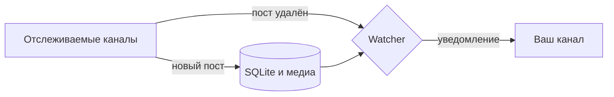

# tg-deleted-watcher

[](https://www.python.org)
[](https://github.com/LonamiWebs/Telethon)
[](https://github.com/astral-sh/ruff)

Userbot, который следит за Telegram-каналами и присылает в ваш канал удалённые посты.

<details>
<summary><b>Example</b></summary>

```
с тгк Channel пропал пост

Post text

Опубликован: 03.11.2026 19:36:11 МСК
Удаление замечено: 21.11.2026 20:52:44 МСК

это автоматическое сообщение бота @my_channel
```

</details>

<details>
<summary><b>Features</b></summary>

- Уведомление приходит сразу после удаления поста
- Фото, видео и файлы сохраняются и отправляются вместе с уведомлением
- Удаления, которые произошли пока бот был выключен, находятся при следующей проверке
- Работает с публичными и приватными каналами
- Длинные посты делятся на несколько сообщений

</details>

<details>
<summary><b>How it works</b></summary>

Обычный бот не может читать чужие каналы, поэтому используется [Telethon](https://github.com/LonamiWebs/Telethon)
и ваш аккаунт (или отдельный аккаунт для слежки).



Все новые и изменённые посты сохраняются в SQLite. Когда Telegram сообщает об удалении,
пост берётся из базы и отправляется в `TARGET_CHANNEL`. Дополнительно каждые
`CHECK_INTERVAL_MIN` минут посты за последние `CHECK_DAYS` дней сверяются с каналом.

</details>

<details>
<summary><b>Installation</b></summary>

Нужен Python 3.10 или новее.

```bash
git clone <url>
cd tg-deleted-watcher
python -m venv .venv
source .venv/bin/activate    # Windows: .venv\Scripts\activate
pip install -e .
```

</details>

<details>
<summary><b>Usage</b></summary>

1. Получите `API_ID` и `API_HASH` на [my.telegram.org](https://my.telegram.org) в разделе API development tools.
2. Скопируйте `.env.example` в `.env` и заполните.
3. Запустите:

```bash
tg-watcher
```

При первом запуске нужно ввести номер телефона, код из Telegram и пароль 2FA, если он есть.
После входа создаётся файл `data/session.session`.

**Не передавайте никому `data/session.session`, с ним можно войти в ваш аккаунт.**

</details>

<details>
<summary><b>Docker</b></summary>

```bash
cp .env.example .env
docker compose run --rm watcher    # вход в аккаунт, потом Ctrl+C
docker compose up -d
```

</details>

<details>
<summary><b>Configuration</b></summary>

Обязательные переменные:

| Переменная | Описание |
|---|---|
| `API_ID`, `API_HASH` | Ключи с my.telegram.org |
| `SOURCE_CHANNELS` | Каналы через запятую: `@name`, `https://t.me/name` или `-100...` |
| `TARGET_CHANNEL` | Ваш канал для уведомлений |

Остальные:

| Переменная | По умолчанию | Описание |
|---|---|---|
| `SIGNATURE` | `это автоматическое сообщение бота` | Подпись в конце уведомления |
| `TZ_OFFSET` | `3` | Часовой пояс, `3` это МСК |
| `SAVE_MEDIA` | `true` | Сохранять медиа |
| `MAX_MEDIA_MB` | `20` | Максимальный размер файла |
| `MEDIA_KEEP_DAYS` | `7` | Сколько дней хранить медиа |
| `BACKFILL_LIMIT` | `50` | Сколько старых постов сохранить при запуске |
| `CHECK_INTERVAL_MIN` | `30` | Как часто перепроверять, в минутах |
| `CHECK_DAYS` | `3` | За сколько дней перепроверять посты |
| `REPORT_UNKNOWN` | `false` | Сообщать о постах, которых нет в базе |
| `DATA_DIR` | `data` | Папка для базы, медиа и сессии |

Аккаунт должен быть подписан на все каналы из `SOURCE_CHANNELS`.

</details>

<details>
<summary><b>Development</b></summary>

```bash
pip install -e ".[dev]"
ruff check .
pytest
```

</details>

<details>
<summary><b>Limitations</b></summary>

- Если пост опубликовали и удалили, пока бот был выключен, его не восстановить.
- Файлы больше `MAX_MEDIA_MB` не сохраняются.
- У Telegram есть лимиты на запросы. Если каналов много, увеличьте `CHECK_INTERVAL_MIN`.

</details>
